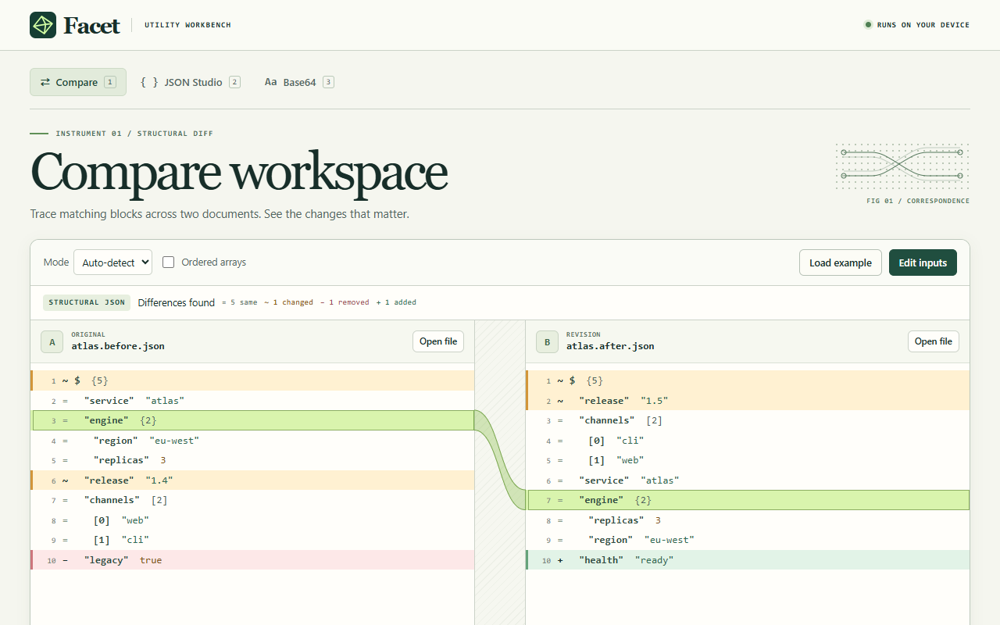
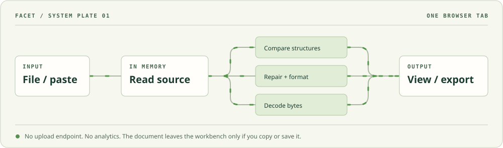

# Facet Workbench

**Compare two documents, repair a JSON file, or decode a string — without sending it anywhere.**

Facet is a small, English-language toolbox that runs in one browser tab. Open it from a folder, a USB drive or a static website. No installation, account, server process, CDN, or runtime dependencies.

[Open the workbench](https://hyfine.github.io/facet-workbench/) · [Watch the walkthrough](https://hyfine.github.io/facet-workbench/docs/demo.html) · [Download offline](https://hyfine.github.io/facet-workbench/facet-offline.zip) · [Architecture](#inside-the-workbench) · [MIT license](LICENSE)

[](https://hyfine.github.io/facet-workbench/docs/demo.html)

## Open it

- **Offline:** download and extract this repository's ZIP, then double-click **`index.html`**. Windows users can also run **`Open Facet.cmd`**. Keep the adjacent `assets` folder. There is nothing to install.
- **Web:** serve `index.html` and `assets/` from any static host. To serve the walkthrough as well, include `docs/`. The same files work under a URL subdirectory. [GitHub Pages instructions ↓](#publishing)
- **First try:** the opening comparison contains two synthetic configurations. Hover over **`engine`** on the left. Its keys appear in the opposite order on the right, but the green ribbon shows the entire block is equal.

The application itself is **under 50 KiB uncompressed**; the optional video is not loaded by the app. No tracking, saved inputs, network API or build step. Reloading resets the workspace. Downloaded files and the system clipboard are outside that boundary.

## The instruments

| Tool | Try it | What you get |
|---|---|---|
| **Compare** | Choose **Edit inputs**, paste each side, then **Compare now**. Or choose **Open file** in either pane. | A split view in original source order. Matching rows link on hover or keyboard focus; `~`, `+` and `−` mark changes independently of color. |
| **JSON Studio** | Paste JSON, or try the imperfect example; switch between **Tree** and **Text**. | Live formatting, explained repairs, wrapping, folding, an expanded dialog, clipboard and file export. Original input is never rewritten. |
| **Base64** | Paste standard Base64, Base64URL or a Base64 data URL. | Readable UTF-8 or BOM-marked UTF-16, byte count, copy and a direct handoff to JSON Studio. Invalid padding and binary input produce an error, not garbled text. |

Use **Alt+1 / Alt+2 / Alt+3** to switch tools. Tab into a comparison pane and press **↑ / ↓** to trace matches. Press **Esc** to close the expanded JSON view.

## What counts as a match?

| Inputs | Result |
|---|---|
| `{"a":1,"b":2}` vs. `{"b":2,"a":1}` | Identical. Object key order never matters, at any depth. |
| `["web","cli","cli"]` vs. `["cli","web","cli"]` | Identical by default. **Ordered arrays** compares by index instead. Duplicate counts are never discarded. |
| `{"old":1}` vs. `{"new":1}` | One removal and one addition. Equal leaf text alone does not connect unrelated fields. |
| `9007199254740992` vs. `9007199254740993` | Changed. Number tokens are preserved; `1.00` and `1e0` still compare equal. |
| Plain text | A bounded longest-common-subsequence line diff keeps matching anchors. Line endings are normalized; trailing newlines and whitespace remain meaningful. |

For unordered arrays, exact subtrees are paired first. Edited remaining records can pair by an unambiguous string or numeric `id`; other unmatched items stay additions/removals. The summary counts terminal values (or a type replacement), not every highlighted ancestor. The view shows both source orders rather than sorting them into a misleading alignment.

**Repair is deliberately conservative.** Studio can remove comments, a BOM and trailing commas, quote bare keys and convert single-quoted strings. It does not evaluate JavaScript, choose between duplicate keys or invent a missing value. The comparison engine uses strict JSON; repair malformed input in Studio or explicitly choose **Text** mode.

**MVP limits:** 1 MiB per file / 1 Mi-character per pasted side; JSON Studio accepts 8,000 values and 96 nesting levels; Compare accepts 3,000 JSON values or 4,000 lines per side. The line diff caps its unmatched matrix at four million cells. Larger inputs get an explicit diagnostic.

## Inside the workbench



| Layer | Responsibility |
|---|---|
| [`assets/json.js`](assets/json.js) | Syntax-aware reader, repair ledger, original key order and exact numeric tokens. |
| [`assets/diff.js`](assets/diff.js) | Structural signatures, one-to-one peer mapping, change counts and bounded line comparison. |
| [`assets/base64.js`](assets/base64.js) | Validates encoded bytes and decodes supported text encodings. |
| [`assets/app.js`](assets/app.js) | Local file I/O, tool routing, native tree/dialog views and an SVG connector drawn from actual row geometry. |

**Adding an instrument:** give it a pure engine in `assets/`, load its classic script before `app.js`, and register the section, navigation link and tool metadata in `index.html` / `app.js`. Keep input in memory, reuse status/error and file controls, and add a focused engine test. Avoid imports that would break `file://` usage.

## Development and verification

The app requires only a current browser. Maintainers can run the dependency-free tests with **Node 22+**:

```sh
node --test tests/core.test.cjs
```

The [walkthrough](docs/demo.html) has a text transcript. It is an actual browser capture of the shipped app, not an animation of a mockup. Its [recording script](scripts/record-demo.cjs) asserts the outcomes. For browser acceptance and recording, install `playwright-core@1.65.1` in a separate tooling folder and set `PLAYWRIGHT_MODULE` to that package's absolute path. Install its FFmpeg via the Playwright CLI (`install ffmpeg`). **Edge** is the default recording browser; set `BROWSER_CHANNEL=chrome` to use installed Chrome.

From the repository root, after setting `DEMO_DIR` to an output folder outside the repository:

```sh
node tests/browser.cjs
node scripts/record-demo.cjs --dry-run
node scripts/record-demo.cjs
```

The dry run produces the real comparison poster. The recording contains three chapters: trace a reordered block, repair and expand JSON, decode and hand off. Only synthetic examples are used.

## Publishing

Create a **new, empty** public repository under the intended GitHub account. Verify the signed-in login before pushing: `gh api user --jq .login`. Do not reuse another account or overwrite an existing remote.

1. Push `main` to the new repository. The **Verify** workflow runs the core tests.
2. Select **Settings → Pages → Source → GitHub Actions**.
3. Run **Actions → Publish Pages → Run workflow** on `main`. The deployment reports the live URL. Set it in the repository's **About → Website** field.
4. The deployed root is the app; `docs/demo.html` plays the video, and `facet-offline.zip` contains just the portable runtime, Windows launcher and license. Run the workflow again when ready to publish an update.

## Contributing

Useful additions are small, offline-first instruments that do one job well. Describe the input, expected output and failure case in your issue or pull request. Use synthetic examples only; never attach private documents. Licensed under [MIT](LICENSE).
